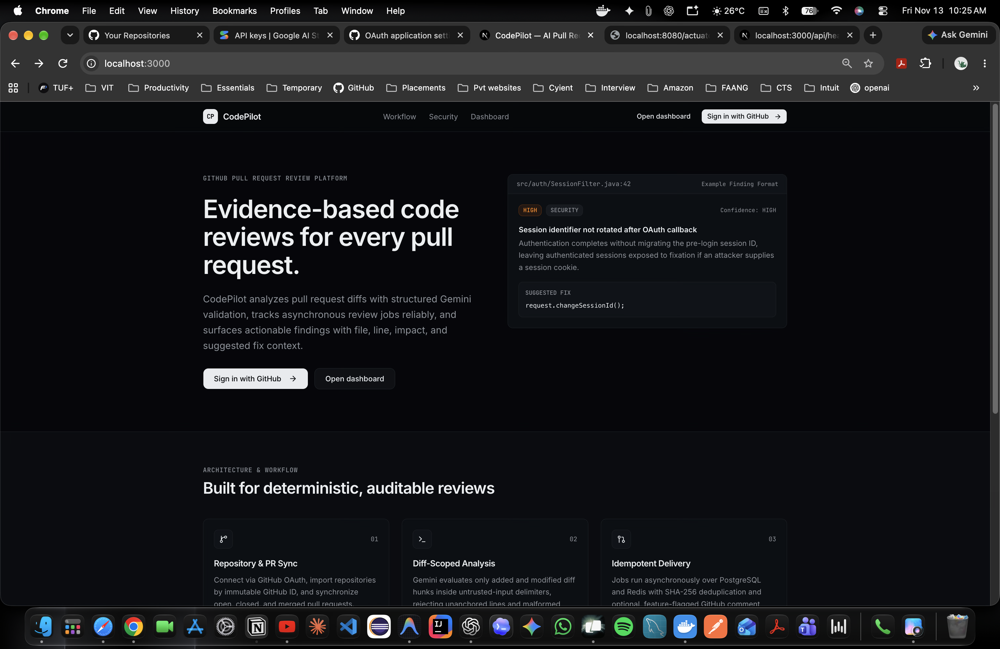
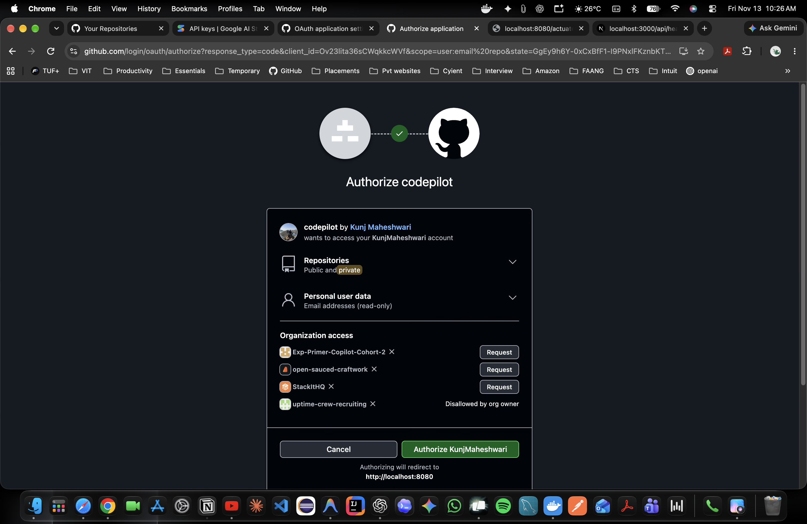
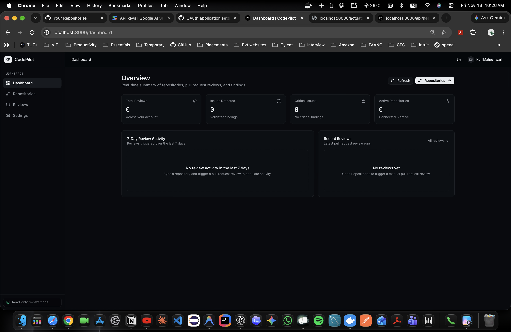
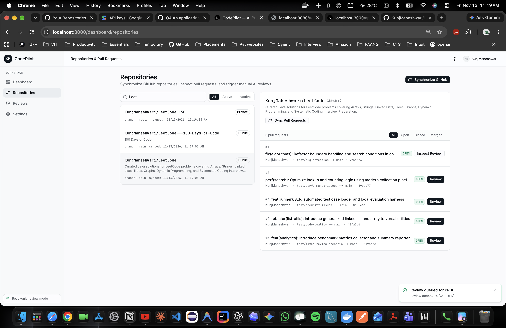
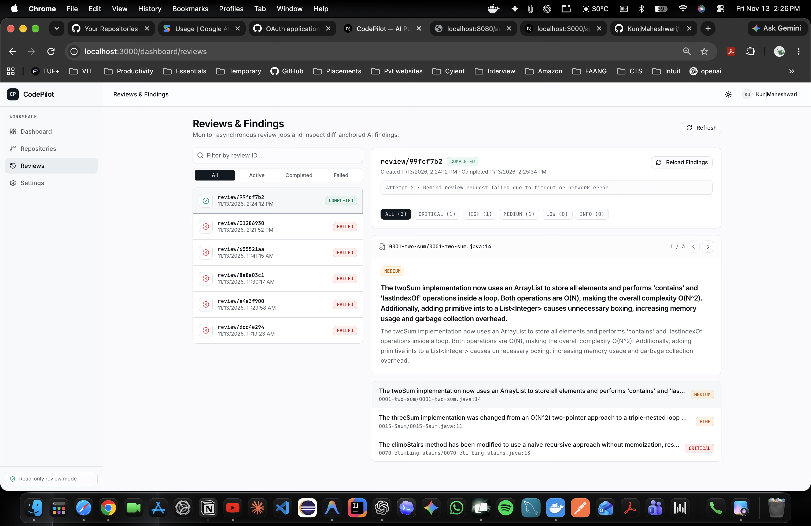
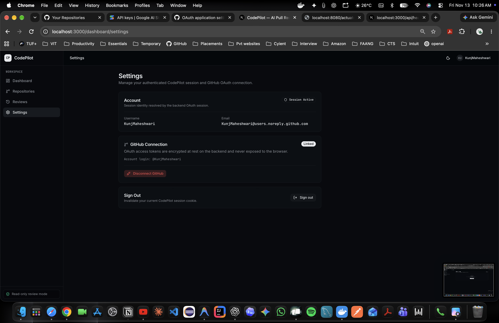
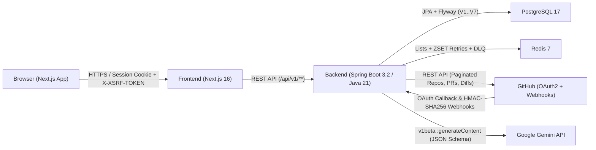

# CodePilot

**AI-powered GitHub Pull Request code-review SaaS platform.**

CodePilot connects to GitHub via OAuth 2.0, synchronizes repositories and pull requests, processes manual and webhook-triggered review jobs asynchronously over Redis, analyzes diffs with Google Gemini using structured JSON validation, and surfaces diff-anchored findings in a modern Next.js dashboard.


---

## Table of Contents

- [Product Overview & Key Capabilities](#product-overview--key-capabilities)
- [Application Screenshots](#application-screenshots)
- [Architecture Overview](#architecture-overview)
- [Technology Stack](#technology-stack)
- [Core Application Workflow](#core-application-workflow)
- [Key Engineering Decisions](#key-engineering-decisions)
- [Repository Structure](#repository-structure)
- [Prerequisites](#prerequisites)
- [Local Development Setup](#local-development-setup)
- [Environment Variable Configuration](#environment-variable-configuration)
- [Docker Compose Setup](#docker-compose-setup)
- [Backend & Frontend Commands](#backend--frontend-commands)
- [Database Migrations & Testing](#database-migrations--testing)
- [API Documentation](#api-documentation)
- [Security Considerations](#security-considerations)
- [Known Limitations & Roadmap](#known-limitations--roadmap)
- [Contribution Guidelines](#contribution-guidelines)

---

## Product Overview & Key Capabilities

- **GitHub OAuth 2.0 Authentication**: Sign in with GitHub (`user:email,repo` scopes); OAuth access tokens are encrypted at rest with AES-256-GCM before persistence in PostgreSQL.
- **Paginated Repository & PR Synchronization**: Imports all accessible GitHub repositories via `Link` (`rel="next"`) pagination and synchronizes pull request metadata (`open`, `closed`, `merged`, branch/SHA details, diff stats).
- **Asynchronous Redis Review Pipeline**: Enqueues review jobs in Redis lists with reliable `RPOPLPUSH` processing queues, sorted-set (`ZSET`) delayed retries with `Retry-After` support, heartbeat tracking, stale-job recovery, and dead-letter queue isolation.
- **Structured Gemini Code Analysis**: Extracts reviewable diff hunks, wraps untrusted repository content in prompt isolation delimiters, enforces a strict JSON response schema, and validates every finding against the actual diff before persistence.
- **Webhook Idempotency & Verification**: Validates GitHub `X-Hub-Signature-256` HMAC signatures in constant time, deduplicates deliveries by `X-GitHub-Delivery`, and processes webhook events asynchronously.
- **Optional GitHub Comment Publishing**: Controlled by `CODEPILOT_REVIEW_PUBLISH_COMMENTS_ENABLED` (default `false` for safe read-only analysis) with SHA-256 publication deduplication.

---

## Application Screenshots

### Landing Page


### GitHub OAuth Consent


### Dashboard Overview


### Repository & Pull Request Management


### Reviews & AI Findings


### Settings & GitHub Integration


<details>
<summary>Additional application state screenshots (empty and failure states)</summary>

- **Repositories Empty State**: [`docs/screenshots/repositories-empty.png`](docs/screenshots/repositories-empty.png)
- **Reviews Empty State**: [`docs/screenshots/reviews-empty.png`](docs/screenshots/reviews-empty.png)
- **Reviews Failed Job State**: [`docs/screenshots/reviews-failed-state.png`](docs/screenshots/reviews-failed-state.png)

</details>

---

## Architecture Overview



---

## Technology Stack

| Layer | Technology |
| :--- | :--- |
| **Frontend** | Next.js `16.4.5` (App Router, Turbopack), React `19.3.0`, TypeScript `5`, Tailwind CSS `4`, Radix UI, Lucide React, Recharts |
| **Backend** | Java `21`, Spring Boot `3.2.3`, Spring Security (OAuth2 Client), Spring Data JPA, Spring Data Redis, Springdoc OpenAPI `2.3.0` |
| **Database** | PostgreSQL `17`, HikariCP, Flyway (`V1`–`V7`) |
| **Queue & Cache** | Redis `7` (AOF persistence) |
| **AI Provider** | Google Gemini API (`v1beta`, configurable model via `GEMINI_API_MODEL`, default `gemini-3-flash-preview`) |
| **Testing** | JUnit 5, Mockito, Testcontainers (`postgres:17-alpine`, `redis:7-alpine`), Playwright (`@playwright/test`), ESLint, `tsc` |
| **Containers & CI** | Docker, Docker Compose, GitHub Actions (`ci.yml`, `deploy.yml`) |

---

## Core Application Workflow

1. **Authenticate**: User signs in via `/oauth2/authorization/github`; Spring Security persists the user and AES-256-GCM encrypted GitHub token.
2. **Synchronize**: User triggers repository sync (`POST /api/v1/repositories/sync`) and PR sync (`POST /api/v1/repositories/{id}/pull-requests/sync`), or GitHub delivers a `pull_request` webhook to `/api/v1/webhooks/github`.
3. **Enqueue**: Creating a review (`POST /api/v1/repositories/{id}/reviews`) creates a `Review` and `ReviewJob` in PostgreSQL and pushes a job message to Redis (`codepilot:review-jobs`).
4. **Analyze**: `ReviewJobWorker` claims the job atomically in PostgreSQL, fetches the PR diff from GitHub, filters reviewable source files (`DiffParser`), invokes `GeminiCodeReviewProvider` with a single bounded HTTP request, and validates findings with `ReviewResponseValidator`.
5. **Retry or Complete**: Transient failures (`429`, `5xx`, timeouts) transition the job to `RETRYING` and schedule a delayed Redis `ZSET` retry; permanent errors (`400`/`401`/`403`/`404`) fail fast as `GEMINI_API_ERROR`; exhausted retries move to `codepilot:review-jobs:dead-letter`.
6. **Inspect**: The frontend polls `/api/v1/reviews/{id}` and `/api/v1/reviews/{id}/job`, rendering structured findings (`CRITICAL`, `HIGH`, `MEDIUM`, `LOW`, `INFO`) with file path, line number, impact, and suggested fix.

---

## Key Engineering Decisions

- **GitHub OAuth**: Uses Spring Security OAuth2 Client (`scope: user:email,repo`) with session fixation protection (`migrateSession()`) and explicit post-login redirect to `${FRONTEND_URL}/dashboard`.
- **Multi-Tenant Security**: Every repository, pull request, review, job, and finding query is scoped to the authenticated user (`ownerId`), returning `404` for unauthorized resource IDs.
- **PostgreSQL & Flyway**: `spring.jpa.hibernate.ddl-auto: validate` ensures runtime entities strictly match Flyway migrations (`V1`–`V7`). No `ddl-auto: update` or embedded test database is used in production.
- **Redis-Based Asynchronous Review Processing**: Decouples HTTP request handling from slow AI/GitHub calls using `RPOPLPUSH` processing queues, 10s DB heartbeats, stale-job recovery (`900s` default timeout), and non-blocking ZSET retries (zero `Thread.sleep()` in Gemini calls).
- **Gemini-Powered Code Analysis**: Uses structured `responseSchema` JSON output, prompt-injection isolation tags (`<untrusted_repository_diff>`), bounded connect/read timeouts (`5s` / `45s`), and typed `GeminiApiException` classification.
- **Webhook Processing & Reliability**: Enforces payload size limits (`1 MB`), constant-time `HmacSHA256` verification (`X-Hub-Signature-256`), and `webhook_deliveries` unique delivery ID idempotency.

---

## Repository Structure

```text
codepilot/
├── .github/workflows/          # CI (ci.yml) and release preparation (deploy.yml)
├── backend/                    # Spring Boot 3.2 / Java 21 API & Redis worker
│   ├── src/main/java/com/codepilot/
│   │   ├── ai/                 # DiffParser, GeminiCodeReviewProvider, prompt/validation
│   │   ├── config/             # Security, CORS, Redis, RateLimitFilter, startup checks
│   │   ├── controller/         # REST controllers & GitHub webhook endpoint
│   │   ├── dto/                # API response/request DTOs
│   │   ├── exception/          # Typed exceptions & GlobalExceptionHandler
│   │   ├── model/              # JPA entities
│   │   ├── repository/         # Spring Data JPA repositories
│   │   └── service/            # Orchestration, GitHub client, encryption, job worker
│   ├── src/main/resources/
│   │   ├── application.yml     # Main application configuration
│   │   └── db/migration/       # Flyway SQL migrations (V1..V7)
│   ├── Dockerfile              # Multi-stage Maven + JRE 21 Alpine image
│   └── pom.xml
├── frontend/                   # Next.js 16 App Router + TypeScript + Tailwind UI
│   ├── src/
│   │   ├── app/                # Landing page, /api/health, /dashboard/* routes
│   │   ├── components/         # UI primitives & workspace shell
│   │   └── lib/                # Typed API client & CSRF/session handling
│   ├── e2e/                    # Playwright end-to-end test suite
│   ├── Dockerfile              # Multi-stage Next.js standalone image
│   └── package.json
├── docs/                       # Audit reports, deployment plan, setup guides & screenshots
├── docker-compose.yml          # Full local stack (PostgreSQL, Redis, Backend, Frontend)
├── .env.example                # Safe environment variable template
└── README.md
```

---

## Prerequisites

- **Docker & Docker Compose** (recommended for full-stack local execution)
- **Java 21 (Eclipse Temurin)** and **Maven 3.9+** (for local backend development/testing)
- **Node.js 22+** and **npm** (for local frontend development/testing)
- **GitHub OAuth App** configured with callback URL `http://localhost:8080/login/oauth2/code/github`
- **Google Gemini API Key**

---

## Local Development Setup

1. **Create your local environment file** from the template:
   ```bash
   cp .env.example .env
   ```
2. **Generate a 256-bit encryption key** and webhook secret:
   ```bash
   openssl rand -hex 32   # Use for ENCRYPTION_KEY
   openssl rand -hex 32   # Use for GITHUB_WEBHOOK_SECRET
   ```
3. **Create a GitHub OAuth App** in GitHub Developer Settings:
   - **Homepage URL**: `http://localhost:3000`
   - **Authorization callback URL**: `http://localhost:8080/login/oauth2/code/github`
4. **Populate `.env`** with your `GITHUB_CLIENT_ID`, `GITHUB_CLIENT_SECRET`, `GITHUB_WEBHOOK_SECRET`, `GEMINI_API_KEY`, `ENCRYPTION_KEY`, and `POSTGRES_PASSWORD`.
5. **Start the full stack**:
   ```bash
   docker compose up -d --build
   ```
6. Open `http://localhost:3000` in your browser.

---

## Environment Variable Configuration

All variables are defined with safe placeholders in [`.env.example`](.env.example).

| Variable | Description | Example / Default |
| :--- | :--- | :--- |
| `POSTGRES_DB` / `POSTGRES_USER` / `POSTGRES_PASSWORD` | PostgreSQL database name and credentials | `codepilot` |
| `REDIS_USERNAME` / `REDIS_PASSWORD` | Optional Redis ACL credentials | `""` |
| `GITHUB_CLIENT_ID` / `GITHUB_CLIENT_SECRET` | GitHub OAuth App credentials | Required |
| `GITHUB_WEBHOOK_SECRET` | HMAC-SHA256 secret for GitHub webhook verification | 64-char hex string |
| `GEMINI_API_KEY` | Google Gemini API key (runtime only) | Required |
| `GEMINI_API_URL` | Gemini REST base URL | `https://generativelanguage.googleapis.com` |
| `GEMINI_API_MODEL` | Gemini model identifier | `gemini-3-flash-preview` |
| `GEMINI_CONNECT_TIMEOUT_MS` / `GEMINI_READ_TIMEOUT_MS` | HTTP client timeouts for Gemini calls | `5000` / `45000` |
| `ENCRYPTION_KEY` | 64-char hex (256-bit) AES-GCM key for GitHub token encryption | Required |
| `ENCRYPTION_PREVIOUS_KEYS` | Optional comma-separated prior keys for zero-downtime rotation | `""` |
| `FRONTEND_URL` / `CORS_ALLOWED_ORIGINS` | Browser origin for OAuth redirect and CORS | `http://localhost:3000` |
| `NEXT_PUBLIC_API_BASE_URL` | Backend URL baked into Next.js client bundle | `http://localhost:8080` |
| `COOKIE_SECURE` / `COOKIE_SAME_SITE` | Session & CSRF cookie flags (`true` / `Lax` or `None` in HTTPS prod) | `false` / `Lax` |
| `CODEPILOT_SWAGGER_PUBLIC` | Expose OpenAPI/Swagger UI publicly | `false` |
| `ACTUATOR_HEALTH_SHOW_DETAILS` | Actuator health detail visibility | `never` |
| `CODEPILOT_REVIEW_PUBLISH_COMMENTS_ENABLED` | Post findings back to GitHub PRs | `false` |

---

## Docker Compose Setup

[`docker-compose.yml`](docker-compose.yml) orchestrates four services with health checks and persistent named volumes (`postgres_data`, `redis_data`):

- `postgres` (`postgres:17-alpine`)
- `redis` (`redis:7-alpine` with `--appendonly yes`)
- `backend` (Spring Boot on port `8080`, health check via `/actuator/health/readiness`)
- `frontend` (Next.js standalone on port `3000`, health check via `/api/health`)

```bash
# Start all services
docker compose up -d --build

# Check service health
docker compose ps

# Follow backend logs
docker compose logs -f backend
```

---

## Backend & Frontend Commands

### Backend (`backend/`)
```bash
cd backend
mvn clean test -B      # Unit tests
mvn verify -B          # Unit + Testcontainers integration tests
mvn spring-boot:run    # Run locally (requires PostgreSQL, Redis, and env vars)
```

### Frontend (`frontend/`)
```bash
cd frontend
npm ci
npm run dev            # Development server on http://localhost:3000
npm run lint           # ESLint
npx tsc --noEmit       # TypeScript typecheck
npm run build          # Production build
npm run test:e2e       # Playwright E2E tests (mocked API)
```

---

## Database Migrations & Testing

- **Migrations**: Managed by Flyway in [`backend/src/main/resources/db/migration/`](backend/src/main/resources/db/migration/) (`V1__init_schema.sql` through `V7__add_github_comment_publications.sql`). Hibernate runs with `ddl-auto: validate`.
- **Backend Verification**: `mvn clean test -B && mvn verify -B` runs unit and Testcontainers-backed integration tests against `postgres:17-alpine` and `redis:7-alpine`.
- **Frontend Verification**: Playwright E2E specs in [`frontend/e2e/`](frontend/e2e/) verify dashboard, repositories, reviews, failed job diagnostics, and settings flows.

---

## API Documentation

- **OpenAPI / Swagger UI**: Exposed at `/swagger-ui.html` and `/v3/api-docs` (requires authentication by default; controlled by `CODEPILOT_SWAGGER_PUBLIC`).
- **Health Probes**:
  - Backend: `/actuator/health`, `/actuator/health/liveness`, `/actuator/health/readiness`
  - Frontend: `/api/health`

---

## Security Considerations

- **Never commit `.env` or secrets**: `.env` is ignored via `.gitignore`.
- **Token Encryption**: GitHub OAuth access tokens are encrypted with AES-256-GCM using `ENCRYPTION_KEY`; zero-downtime rotation is supported via `ENCRYPTION_PREVIOUS_KEYS`.
- **CSRF & Cookies**: Spring Security uses `CookieCsrfTokenRepository` (`XSRF-TOKEN` / `X-XSRF-TOKEN`) and `HttpOnly` `JSESSIONID` cookies. In production HTTPS, set `COOKIE_SECURE=true`.
- **Prompt Injection Defense**: Untrusted repository diffs are delimited in `<untrusted_repository_diff>` tags and validated against diff file/line bounds before saving.
- **Actuator & Swagger**: Keep `CODEPILOT_SWAGGER_PUBLIC=false` and `ACTUATOR_HEALTH_SHOW_DETAILS=never` in production.

---

## Known Limitations & Roadmap

- **Single-Instance Rate Limiting & Sessions**: `RateLimitFilter` uses an in-memory `ConcurrentHashMap`, and HTTP sessions are stored in Tomcat memory. Horizontal scaling (>1 backend replica) requires moving sessions to Spring Session Redis and rate limiting to Redis.
- **Cross-Origin Production Deployment (Vercel + Render)**: Split-origin deployments require either Next.js `rewrites()` proxying or shared-domain cookie configuration so `XSRF-TOKEN` and `JSESSIONID` work across frontend and backend origins (documented in [`docs/PRODUCTION_DEPLOYMENT_PLAN.md`](docs/PRODUCTION_DEPLOYMENT_PLAN.md)).
- **Comment Publishing Off by Default**: `CODEPILOT_REVIEW_PUBLISH_COMMENTS_ENABLED` defaults to `false` for safe read-only evaluation before enabling automated PR comments.

---

## Contribution Guidelines

1. Fork the repository and create a feature branch from `main`.
2. Never commit `.env` files, API keys, or credentials.
3. Add or update unit/integration tests for backend changes and Playwright/type checks for frontend changes.
4. Run the full verification suite before opening a pull request:
   - `cd backend && mvn clean test -B && mvn verify -B`
   - `cd frontend && npm run lint && npx tsc --noEmit && npm run build && npx playwright test`
5. Ensure `git diff --check` reports no whitespace or formatting issues.
