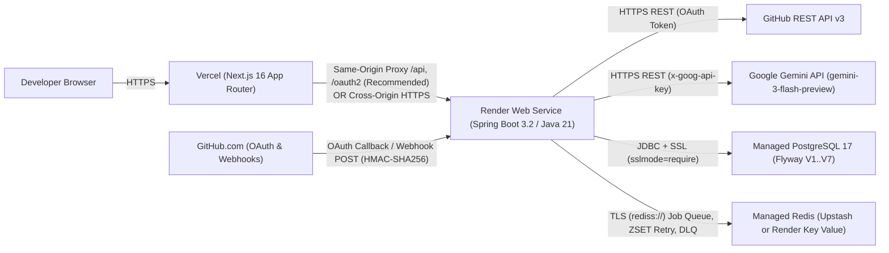

# CodePilot — Production Deployment Plan & Readiness Audit

**Audit Date:** 2026-11-13  
**Audit Mode:** Read-Only Architectural & Deployment Audit  
**Target Stack:** Vercel (Next.js) + Render (Spring Boot) + Managed PostgreSQL + Managed Redis (Upstash / Render Key Value) + GitHub + Google Gemini API

---

## Executive Status Classification

| Status | Meaning |
| :--- | :--- |
| **VERIFIED** | Directly confirmed in repository source, configuration, Dockerfiles, migrations, or workflows during this audit. |
| **REQUIRED CHANGES** | Code or configuration changes that must be completed before production deployment will succeed. |
| **BLOCKED** | Production capabilities that cannot function safely until a blocker is resolved. |
| **NOT VERIFIED** | Runtime behaviors on live Vercel, Render, managed PostgreSQL, or managed Redis that cannot be verified in a read-only local audit. |

---

## A. Architecture Diagram

---

## B. Service-by-Service Deployment Plan

### 1. Frontend — Vercel (Next.js)
- **VERIFIED**:
  - `frontend/package.json` uses Next.js `16.4.5`, React `19.3.0`, TypeScript `5`, Tailwind CSS `4`.
  - `frontend/next.config.ts` sets `output: "standalone"`, `cacheComponents: true`, `partialPrefetching: true`. Vercel builds Next.js App Router directly when **Root Directory** is set to `frontend`.
  - Only one public environment variable is referenced in `frontend/src/lib/api.ts`: `NEXT_PUBLIC_API_BASE_URL` (defaults to `"http://localhost:8080"`). No secrets are exposed via `NEXT_PUBLIC_*`.
- **BLOCKED / REQUIRED CHANGES**:
  - **Cross-Origin CSRF & Cookie Isolation**: `frontend/src/lib/api.ts` sets `credentials: "include"` and calls `readCookie("XSRF-TOKEN")` via `document.cookie` to attach `X-XSRF-TOKEN`. When Vercel (`*.vercel.app`) and Render (`*.onrender.com`) are on separate origins, `document.cookie` on the Vercel origin **cannot read** the `XSRF-TOKEN` cookie set by the Render origin. Every `POST`/`PUT`/`PATCH`/`DELETE` request will omit `X-XSRF-TOKEN` and fail with `403 Forbidden`. Third-party `JSESSIONID` cookies are also blocked or partitioned by Safari ITP / Firefox ETP / Chrome across different eTLD+1 domains.
  - **Recommended Fix**: Add Next.js `rewrites()` in `frontend/next.config.ts` (proxying `/api/:path*`, `/oauth2/:path*`, `/login/oauth2/:path*` to the Render backend URL) **or** host on a shared custom domain (`app.<domain>` + `api.<domain>`) with cookie domain sharing / JSON CSRF token delivery.

### 2. Backend — Render (Spring Boot Web Service)
- **VERIFIED**:
  - `backend/Dockerfile` builds a fat JAR via `maven:3.9.9-eclipse-temurin-21-alpine` and runs it on `eclipse-temurin:21-jre-alpine` as non-root user `codepilot` with `-XX:MaxRAMPercentage=75.0 -XX:+UseG1GC`.
  - `application.yml` configures `server.shutdown: graceful`, `spring.lifecycle.timeout-per-shutdown-phase: 30s`, and `StartupLifecycleLogger` emits structured startup/shutdown logs without secrets.
  - Actuator liveness/readiness probes (`/actuator/health`, `/actuator/health/liveness`, `/actuator/health/readiness`) are enabled and permitted in `SecurityConfig.java`.
  - No local filesystem state is used; all persistent state lives in PostgreSQL and Redis.
- **REQUIRED CHANGES**:
  - **Render `PORT` Binding**: `application.yml` does **not** set `server.port: ${PORT:8080}`. Render injects `PORT` (default `10000`) for Web Services. Either add `server.port: ${PORT:8080}` to `application.yml` (and update `Dockerfile` `HEALTHCHECK` port) **or** explicitly set `PORT=8080` in Render environment variables.
  - **JVM Memory Sizing**: Render Starter (512 MB RAM) is tight for a Spring Boot 3 + Tomcat + HikariCP + Lettuce + Jackson JVM even with `-XX:MaxRAMPercentage=75.0` (~384 MB heap + metaspace/native memory). Render **Standard (2 GB RAM)** is recommended for production reliability.
- **Render Web Service Settings**:
  - **Environment**: Docker
  - **Root Directory**: `backend`
  - **Dockerfile Path**: `./Dockerfile`
  - **Health Check Path**: `/actuator/health/readiness`

### 3. Managed PostgreSQL
- **VERIFIED**:
  - `backend/src/main/resources/db/migration/` contains 7 sequential Flyway migrations (`V1__init_schema.sql` through `V7__add_github_comment_publications.sql`).
  - `application.yml` enables Flyway (`enabled: true`, `baseline-on-migrate: true`) and Hibernate schema validation (`ddl-auto: validate`).
  - `backend/src/main/resources/` contains no test configuration (`h2` is `scope: test` in `pom.xml`).
  - HikariCP is bounded (`maximum-pool-size: 10`, `minimum-idle: 2`, `connection-timeout: 5000ms`).
- **REQUIRED CHANGES**:
  - Append `?sslmode=require` to `DB_URL` (`jdbc:postgresql://<host>:<port>/<db>?sslmode=require`) for managed PostgreSQL TLS enforcement.
- **NOT VERIFIED**:
  - Migration execution against an empty managed PostgreSQL instance (`Render Postgres` / `Neon`) has not yet been run in production, though `V1`–`V7` are verified in local Docker Compose and Testcontainers (`postgres:17-alpine`).

### 4. Managed Redis (Upstash or Render Key Value)
- **VERIFIED**:
  - `ReviewJobWorker` uses Redis `rightPopAndLeftPush` (`codepilot:review-jobs` → `codepilot:review-jobs:processing`), ZSET delayed retries (`codepilot:review-jobs:retry`), and dead-letter list (`codepilot:review-jobs:dead-letter`).
  - Worker crash recovery is backed by PostgreSQL heartbeats (`heartbeat()` every 10s) and `recoverStaleJobs()` after `processing-timeout-seconds` (default `900s`), plus `ReviewJobProducer` DB fallback polling.
- **REQUIRED CHANGES**:
  - `application.yml` (`spring.data.redis`) currently binds `host`, `port`, `username`, `password`, but does **not** bind `url` or `ssl.enabled`. Managed Redis providers (Upstash, Render Key Value) require TLS (`rediss://...`). Set `SPRING_DATA_REDIS_URL=rediss://default:<password>@<host>:<port>` at runtime (Spring Boot relaxed binding) **or** add `url: ${REDIS_URL:}` / `ssl.enabled: ${REDIS_SSL_ENABLED:false}` to `application.yml`.
  - Configure Redis eviction policy to **`noeviction`** so queued review jobs are never dropped under memory pressure.
  - For **Upstash**, use the **Redis TLS (`rediss://`) endpoint**, not the REST API URL, and verify connection keepalive under idle timeouts.

---

## C. Exact Build and Startup Commands

| Service | Build Command | Startup / Runtime Command |
| :--- | :--- | :--- |
| **Frontend (Vercel)** | `npm ci && npm run build` (Root Directory: `frontend`) | Managed by Vercel Next.js runtime |
| **Backend (Render Docker)** | `mvn clean package -DskipTests -B` (via `backend/Dockerfile`) | `java -XX:MaxRAMPercentage=75.0 -XX:+UseG1GC -Djava.security.egd=file:/dev/urandom -jar /app/app.jar` |
| **Backend (CI Validation)** | `cd backend && mvn clean test -B && mvn verify -B` | N/A |
| **Frontend (CI Validation)** | `cd frontend && npm ci && npm run lint && npx tsc --noEmit && npm run build && npx playwright test` | N/A |

---

## D. Complete Environment Variable Inventory

### Frontend (Vercel)

| Variable Name | Service | Required / Optional | Secret | Description |
| :--- | :--- | :--- | :--- | :--- |
| `NEXT_PUBLIC_API_BASE_URL` | Vercel (Build & Runtime) | Required | No | Public backend origin (`https://api.<domain>` or empty/relative `""` if using Next.js `rewrites` proxy). |

### Backend (Render)

| Variable Name | Service | Required / Optional | Secret | Description |
| :--- | :--- | :--- | :--- | :--- |
| `PORT` | Render | Optional (Required if `server.port` not bound to `${PORT}`) | No | Set to `8080` until `application.yml` sets `server.port: ${PORT:8080}`. |
| `DB_URL` | Render | Required | No (creds separate) | JDBC URL with SSL: `jdbc:postgresql://<host>:<port>/<db>?sslmode=require`. |
| `DB_USERNAME` | Render | Required | No | Managed PostgreSQL username. |
| `DB_PASSWORD` | Render | Required | **Yes** | Managed PostgreSQL password. |
| `DB_POOL_MAX_SIZE` | Render | Optional | No | Hikari max pool size (default `10`; keep within DB plan limits). |
| `DB_POOL_MIN_IDLE` | Render | Optional | No | Hikari min idle connections (default `2`). |
| `SPRING_DATA_REDIS_URL` | Render | Required (for managed TLS Redis) | **Yes** | Full `rediss://default:<password>@<host>:<port>` connection string (overrides `REDIS_HOST`/`PORT`). |
| `REDIS_HOST` / `REDIS_PORT` | Render | Optional (if `SPRING_DATA_REDIS_URL` set) | No | Legacy non-TLS host/port fallback (`localhost:6379`). |
| `REDIS_USERNAME` / `REDIS_PASSWORD` | Render | Optional (if `SPRING_DATA_REDIS_URL` set) | **Yes** | Redis ACL credentials. |
| `GITHUB_CLIENT_ID` | Render | Required | No | Production GitHub OAuth App Client ID. |
| `GITHUB_CLIENT_SECRET` | Render | Required | **Yes** | Production GitHub OAuth App Client Secret. |
| `GITHUB_WEBHOOK_SECRET` | Render | Required | **Yes** | High-entropy HMAC-SHA256 webhook secret (`openssl rand -hex 32`). |
| `GEMINI_API_KEY` | Render | Required | **Yes** | Fresh production Google Gemini API key (do not reuse any previously exposed key). |
| `GEMINI_API_URL` | Render | Optional | No | Default `https://generativelanguage.googleapis.com`. |
| `GEMINI_API_MODEL` | Render | Required in Prod | No | Set explicitly to `gemini-3-flash-preview` (default in `application.yml`; local `.env` had `gemini-3.8-flash` which timed out). |
| `GEMINI_CONNECT_TIMEOUT_MS` | Render | Optional | No | Connect timeout in ms (default `5000`, max `30000`). |
| `GEMINI_READ_TIMEOUT_MS` | Render | Optional | No | Read timeout in ms (default `45000`, max `120000`). |
| `ENCRYPTION_KEY` | Render | Required | **Yes** | Fresh 64-hex-char 256-bit AES-GCM key (`openssl rand -hex 32`). |
| `ENCRYPTION_PREVIOUS_KEYS` | Render | Optional | **Yes** | Comma-separated previous 64-hex-char keys for zero-downtime key rotation. |
| `FRONTEND_URL` | Render | Required | No | Production Vercel URL (`https://<frontend-domain>`), no trailing slash. |
| `CORS_ALLOWED_ORIGINS` | Render | Required | No | Exact frontend origin (`https://<frontend-domain>`). |
| `COOKIE_SECURE` | Render | Required | No | Must be `true` in production HTTPS. |
| `COOKIE_SAME_SITE` | Render | Required | No | `Lax` if same-site/proxied via Vercel rewrites; `None` if cross-origin HTTPS. |
| `SESSION_TIMEOUT` | Render | Optional | No | Default `30m`. |
| `FORWARD_HEADERS_STRATEGY` | Render | Optional | No | Default `framework` (required behind Render TLS reverse proxy for OAuth redirect URI reconstruction). |
| `CODEPILOT_SWAGGER_PUBLIC` | Render | Optional | No | Keep `false` in production. |
| `ACTUATOR_HEALTH_SHOW_DETAILS` | Render | Optional | No | Keep `never` in production. |
| `CODEPILOT_REVIEW_PUBLISH_COMMENTS_ENABLED` | Render | Optional | No | Keep `false` during initial smoke testing; enable (`true`) only after verifying review quality. |
| `CODEPILOT_REVIEW_ASYNC_ENABLED` | Render | Optional | No | Default `true`. |
| `CODEPILOT_REVIEW_MAX_ATTEMPTS` | Render | Optional | No | Default `3`. |
| `CODEPILOT_RATE_LIMIT_ENABLED` | Render | Optional | No | Default `true`. |

---

## E. Required GitHub OAuth & Webhook Settings

1. **Create a Dedicated Production GitHub OAuth App** (GitHub Apps/OAuth Apps only allow one callback URL per OAuth App; do not reuse local dev):
   - **Homepage URL**: `https://<frontend-domain>`
   - **Authorization callback URL**:
     - Direct backend origin: `https://<backend-domain>/login/oauth2/code/github`
     - Or if using Next.js rewrites proxy: `https://<frontend-domain>/login/oauth2/code/github`
   - **Requested OAuth Scopes** (`application.yml`): `user:email,repo`
2. **GitHub Repository / Organization Webhook Settings**:
   - **Payload URL**: `https://<backend-domain>/api/v1/webhooks/github`
   - **Content type**: `application/json`
   - **Secret**: Exact value of `GITHUB_WEBHOOK_SECRET`
   - **SSL verification**: Enabled
   - **Events**: Select **Let me select individual events** → **Pull requests** (`opened`, `synchronize`, `reopened`).
3. **GitHub API Rate-Limit Handling (VERIFIED)**:
   - `GitHubApiClient` parses `Retry-After` and `X-RateLimit-Reset` headers and retries transient `429`/`5xx`/`403` rate-limit responses up to 3 attempts (bounded wait `<= 5s`).

---

## F. CORS, CSRF, and Cookie Changes Required for Production

- **VERIFIED**:
  - `SecurityConfig.java` enforces `corsConfigurationSource()` with explicit `allowedOrigins` (rejecting `*`), `allowCredentials(true)`, and `CookieCsrfTokenRepository.withHttpOnlyFalse()`.
  - `AuthController.java` exposes `/api/v1/auth/csrf` and `/api/v1/auth/logout` clears `JSESSIONID` and `XSRF-TOKEN`.
- **REQUIRED CHANGES (CRITICAL)**:
  1. **Solve Cross-Origin CSRF & Third-Party Cookie Blocking**:
     - **Option 1 (Recommended — Same-Origin via Vercel Rewrites)**: Configure `rewrites()` in `frontend/next.config.ts` so browser requests to `/api/:path*`, `/oauth2/:path*`, and `/login/oauth2/:path*` proxy to `https://<backend-domain>`. Then `NEXT_PUBLIC_API_BASE_URL=""`, `COOKIE_SECURE=true`, `COOKIE_SAME_SITE=Lax`, and `XSRF-TOKEN` is readable by `document.cookie` on the frontend domain with zero third-party cookie issues.
     - **Option 2 (Custom Subdomains)**: Host `app.<domain>` (Vercel) and `api.<domain>` (Render), set `Domain=.<domain>` on `JSESSIONID` and `XSRF-TOKEN` cookies in `SecurityConfig.java`, and set `COOKIE_SECURE=true`, `COOKIE_SAME_SITE=Lax` (same-site!).
  2. **Reverse Proxy Headers**: Keep `server.forward-headers-strategy: framework` so Spring Security OAuth2 builds `https://` redirect URIs behind Render's TLS terminator.

---

## G. Database Migration & Redis Configuration Plan

1. **PostgreSQL**:
   - Provision managed PostgreSQL 17 with automated daily backups / Point-in-Time Recovery (PITR).
   - Run backend startup against the empty database; Flyway automatically executes `V1`–`V7` in order, then Hibernate `ddl-auto: validate` verifies all entity mappings.
   - **Never** modify already-applied Flyway migrations; all future schema changes must be new `V8+` forward migrations.
2. **Redis**:
   - Provision persistent managed Redis (Upstash Pay-As-You-Go or Render Key Value Starter) with `noeviction` policy.
   - Inject `SPRING_DATA_REDIS_URL=rediss://...` into Render environment variables.
   - Verify `ReviewJobWorker` starts and processes queued jobs without `RedisConnectionFailureException` or TLS handshake errors.

---

## H. Security Risks & Blockers

1. **BLOCKER — Cross-Origin `XSRF-TOKEN` Unreadable on Vercel**: `readCookie("XSRF-TOKEN")` in `frontend/src/lib/api.ts` fails when frontend and backend are on different domains (`*.vercel.app` vs `*.onrender.com`), breaking all `POST`/`PUT`/`DELETE` API calls.
2. **BLOCKER — `server.port` Not Bound to `${PORT}`**: `application.yml` defaults to `8080`, whereas Render injects `PORT` (default `10000`). Must bind `server.port: ${PORT:8080}` or set `PORT=8080` in Render.
3. **BLOCKER — Redis TLS (`rediss://`) Not Explicitly Configured**: `application.yml` lacks `spring.data.redis.url` / `ssl.enabled`; must inject `SPRING_DATA_REDIS_URL` or add TLS properties.
4. **RISK (Single-Instance Constraint) — In-Memory Rate Limiting & HTTP Sessions**:
   - `RateLimitFilter` uses an in-memory `ConcurrentHashMap` and reads `X-Forwarded-For` directly.
   - HTTP sessions (`JSESSIONID`) are stored in-memory in Tomcat.
   - **Impact**: Safe for **1** Render backend instance. Scaling to **>1** backend instances requires migrating sessions to Spring Session Redis and rate limiting to Redis.
5. **VERIFIED — Git & Secret Hygiene**:
   - `git ls-files` confirms `.env` is **not** tracked in Git (only `.env.example` and `backend/.env.example`).
   - `git log --all -S "AIzaSy"` returned **0** commits.
   - **Action**: Generate brand-new production values for `GEMINI_API_KEY`, `ENCRYPTION_KEY`, `GITHUB_CLIENT_SECRET`, and `GITHUB_WEBHOOK_SECRET`; never reuse local dev secrets.
6. **VERIFIED — Tenant Isolation & Hardening**:
   - `RepositoryService.getOwnedRepository` scopes data access by authenticated user `ownerId`.
   - `CODEPILOT_SWAGGER_PUBLIC=false` and `ACTUATOR_HEALTH_SHOW_DETAILS=never` by default.

---

## I. Estimated Monthly Cost Ranges (USD & INR)

*Assumptions: 1 USD ≈ ₹85 INR; low-to-moderate initial SaaS traffic; always-on backend required for webhook/Redis workers.*

> [!WARNING]
> **Free-tier limitations**: Render Free web services spin down after 15 minutes of inactivity (halting `@Scheduled` Redis workers and causing 50s+ cold starts that fail GitHub webhook 10s timeouts), Render Free PostgreSQL expires after 30 days, and Render Free Redis is ephemeral. **Do not use Render Free tier for production.**

### Option 1: Lean Production (Personal / Early Beta)
- **Vercel Hobby**: \$0/mo (non-commercial only)
- **Render Starter Web Service** (512 MB RAM, always-on): \$7/mo *(tight for Spring Boot JVM; monitor OOM)*
- **Render Postgres Starter** (1 GB) or **Supabase Free/Pro**: \$7/mo
- **Upstash Redis Pay-As-You-Go**: \$0–\$5/mo (TLS, persistent)
- **Gemini API (`gemini-3-flash-preview`)**: ~\$1–\$5/mo (usage-based)
- **Total**: **~\$15–\$24/mo (≈ ₹1,275–₹2,040/mo)**

### Option 2: Recommended Production (Commercial SaaS)
- **Vercel Pro**: \$20/mo
- **Render Standard Web Service** (2 GB RAM, 1 CPU, always-on): \$25/mo
- **Managed PostgreSQL** (Render Basic-1GB \$19/mo or Neon Launch \$19/mo or Supabase Pro \$25/mo): \$19–\$25/mo
- **Managed Redis** (Render Key Value Starter 256 MB \$10/mo or Upstash \$5–\$10/mo): \$5–\$10/mo
- **Gemini API (`gemini-3-flash-preview`)**: ~\$2–\$10/mo (usage-based)
- **Total**: **~\$71–\$90/mo (≈ ₹6,035–₹7,650/mo)**

---

## J. Ordered Deployment Checklist

1. **Pre-Deployment Code Fixes** (separate approved implementation phase):
   - Add Next.js `rewrites()` (or shared-domain cookie/CSRF support) to resolve cross-origin CSRF & `JSESSIONID`.
   - Add `server.port: ${PORT:8080}` and `spring.data.redis.url: ${REDIS_URL:}` / `ssl.enabled: ${REDIS_SSL_ENABLED:false}` in `application.yml`.
2. **Provision Infrastructure**:
   - Create Managed PostgreSQL 17 database with automated backups enabled.
   - Create Managed Redis (`noeviction` policy, TLS enabled).
   - Create Production GitHub OAuth App and note `Client ID` + `Client Secret`.
   - Generate fresh `ENCRYPTION_KEY` (`openssl rand -hex 32`), `GITHUB_WEBHOOK_SECRET` (`openssl rand -hex 32`), and fresh production `GEMINI_API_KEY`.
3. **Deploy Backend on Render**:
   - Create Docker Web Service (`root: backend`, health check: `/actuator/health/readiness`), configure all backend env vars (`GEMINI_API_MODEL=gemini-3-flash-preview`, `COOKIE_SECURE=true`, `CODEPILOT_REVIEW_PUBLISH_COMMENTS_ENABLED=false`).
   - Verify `/actuator/health/readiness` returns `{"status":"UP"}` and Flyway `V1`–`V7` succeed in logs.
4. **Deploy Frontend on Vercel**:
   - Import repo with Root Directory `frontend`, set `NEXT_PUBLIC_API_BASE_URL`, deploy.
5. **Configure GitHub Webhook & Smoke Test**:
   - Point repository webhook to `https://<backend-domain>/api/v1/webhooks/github` with `GITHUB_WEBHOOK_SECRET`.
   - Sign in via GitHub OAuth, sync a repository, trigger a PR review, verify findings appear in UI.
   - Optionally enable `CODEPILOT_REVIEW_PUBLISH_COMMENTS_ENABLED=true` once review quality is confirmed.

---

## K. Rollback and Recovery Plan

- **Application Rollback (Frontend / Backend)**:
  - **Vercel**: Instant 1-click rollback to the previous immutable deployment in the Vercel Dashboard.
  - **Render**: Instant rollback to the previous Docker build/commit in the Render Dashboard.
- **Database Rollback**:
  - Flyway migrations (`V1`–`V7`) are forward-only. Before any future `V8+` migration, take a managed PostgreSQL snapshot/checkpoint. If a schema change breaks production, restore the pre-migration DB snapshot or deploy a compensating forward migration (`V9__revert_...sql`).
- **Encryption Key Rotation / Recovery**:
  - Never delete or overwrite `ENCRYPTION_KEY` without keeping the prior key in `ENCRYPTION_PREVIOUS_KEYS` (`EncryptionService` automatically falls back on `AEADBadTagException`).
- **AI / Queue Incident Mitigation**:
  - Set `CODEPILOT_REVIEW_PUBLISH_COMMENTS_ENABLED=false` to immediately stop external PR comment posting while keeping the dashboard operational.
  - Set `CODEPILOT_REVIEW_ASYNC_ENABLED=false` to pause background worker consumption during upstream Gemini outages without losing queued jobs in PostgreSQL/Redis.

